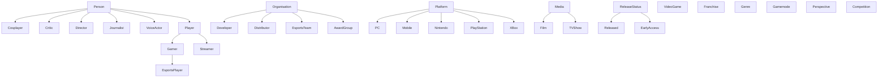

# The Video Game Ontology

`backend/data/video_game.rdf` is an OWL ontology authored in Protégé. It models video games and the ecosystem around them.

| | Count |
|---|---|
| Classes | 33 named (plus 2 anonymous) |
| Object properties | 19 |
| Data properties | 28 |
| Individuals | 111 (26 games, 15 developers, 21 genres, 16 platforms, …) |
| Triples | 1066 |

## Class hierarchy

## Core relationships

| Property | Domain → Range | Notes |
|---|---|---|
| `developedBy`, `directedBy`, `distributedBy` | VideoGame → Developer / Director / Distributor | Irreflexive |
| `hasGenre`, `hasGamemode`, `hasPerspective` | VideoGame → Genre / Gamemode / Perspective | |
| `availableOn` ↔ `hasGames` | VideoGame ↔ Platform | Inverse pair |
| `prequelOf` ↔ `sequelOf` | VideoGame ↔ VideoGame | Inverse pair |
| `similarTo` | VideoGame → VideoGame | **Symmetric**, used by the recommender |
| `inFranchise` | VideoGame → Franchise | |
| `hasMediaAdaptation` ↔ `basedOnGame` | VideoGame ↔ Media | Inverse pair, `basedOnGame` symmetric |
| `streamsGame` | Streamer → VideoGame | |
| `competesIn`, `memberOf` | EsportsPlayer → Competition / EsportsTeam | |

## Axioms

- `ageRating` and `releaseDate` are **functional** (one value per game).
- `Person` is **disjoint with** `VideoGame`.
- `developedBy`, `directedBy`, `distributedBy` are **irreflexive**.
- `similarTo` and `basedOnGame` are **symmetric**.

## Known data gaps

- Several games have no `releaseDate`, and Deadlock's is set to 2027-06-14, which is likely a typo.
- Entities have no `rdfs:label`, so the API derives display names from IRI fragments (`ArrowheadGameStudios`). Adding labels is the cleanest fix.
- The ontology namespace is a placeholder (`example.org`). Move it to a stable, resolvable IRI before publishing the ontology as a vocabulary.
- Only the original 10 games have `gameTrailer` links; for the rest the UI falls back to a YouTube search link. Cover images for new games use the Steam CDN.
